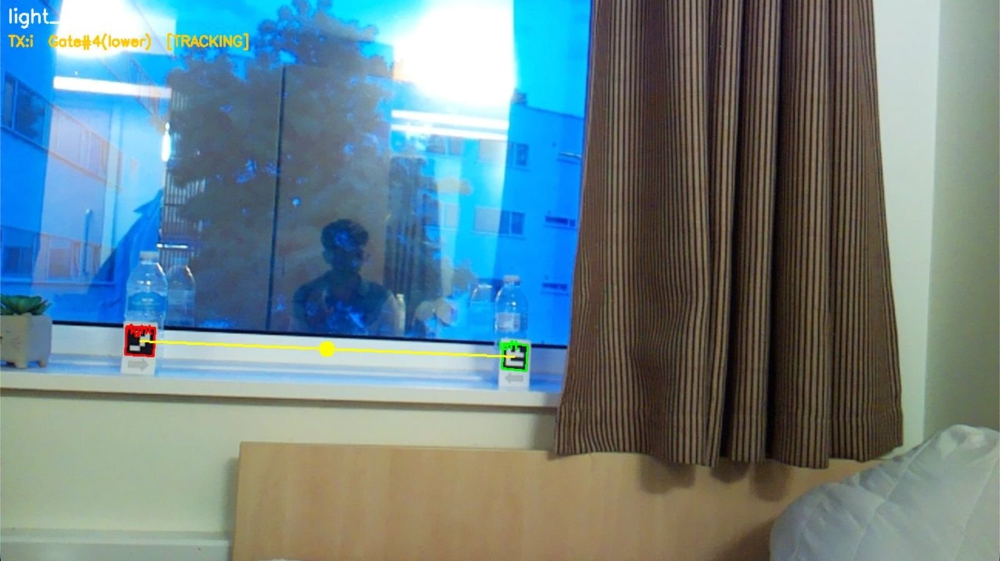
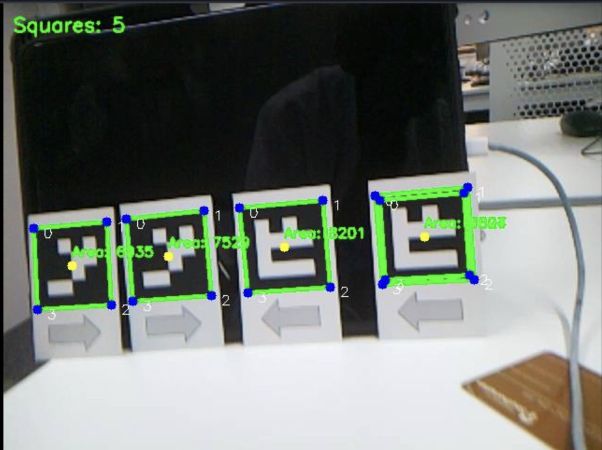
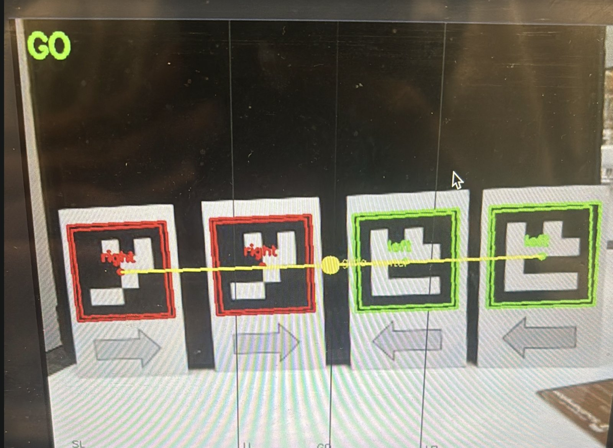
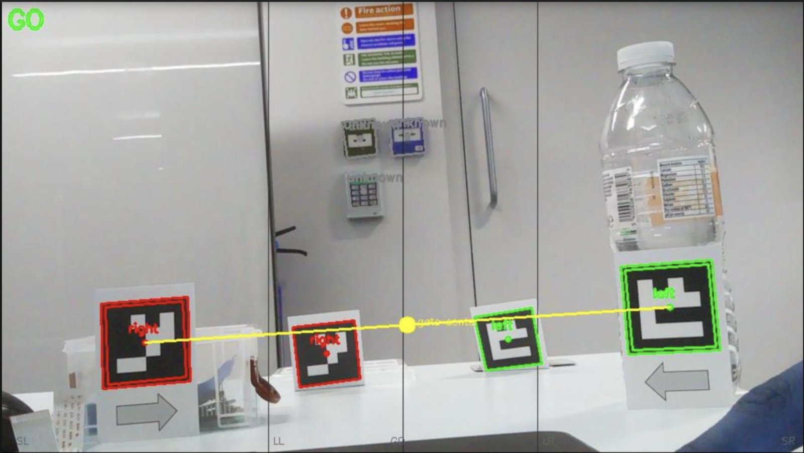
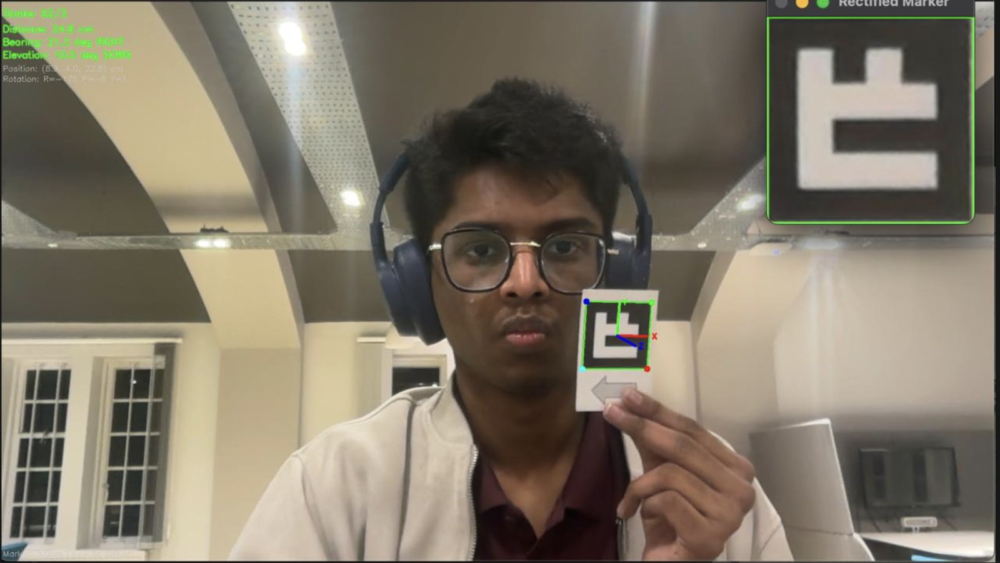
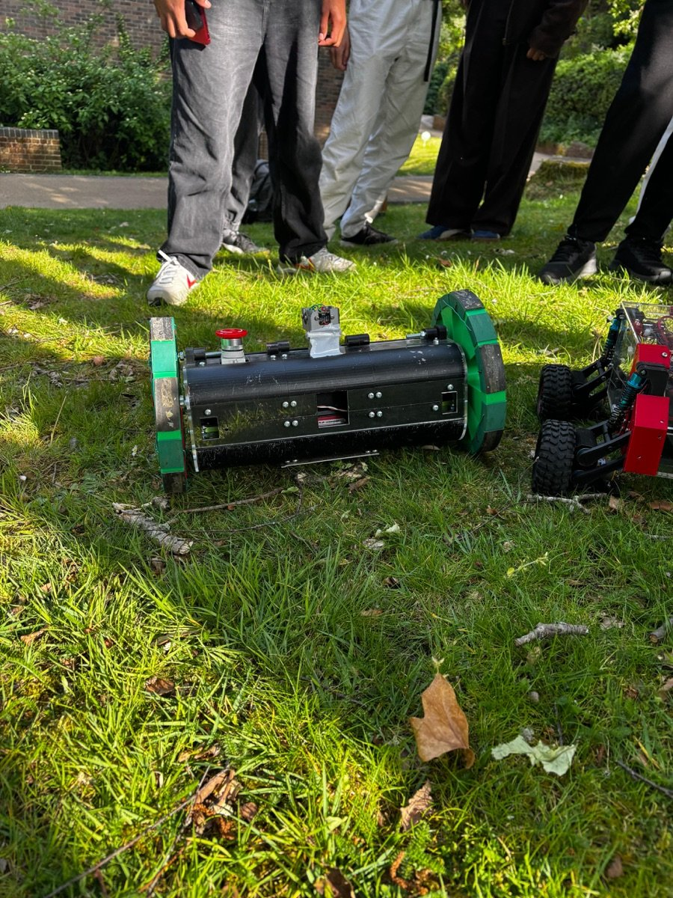
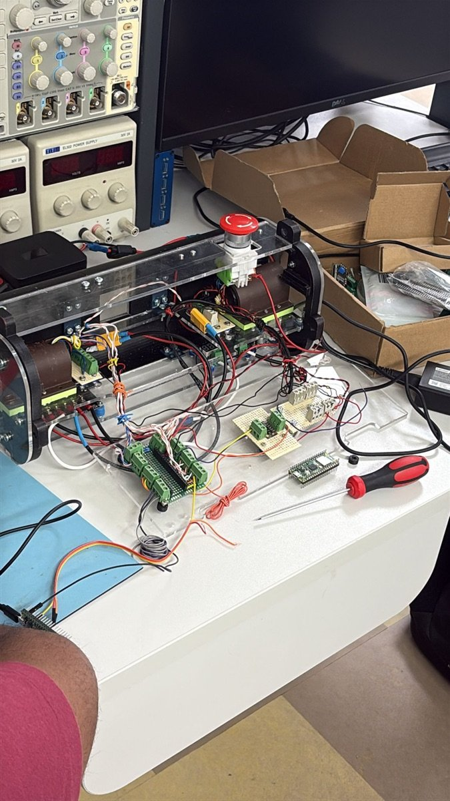
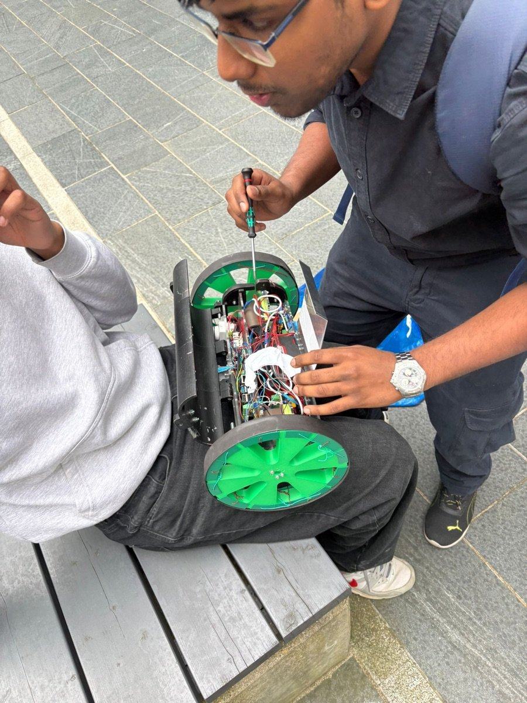
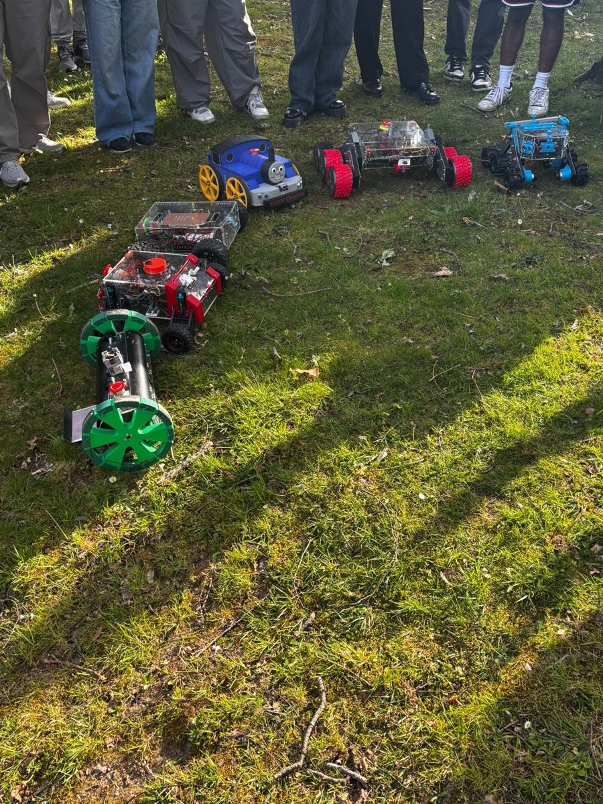
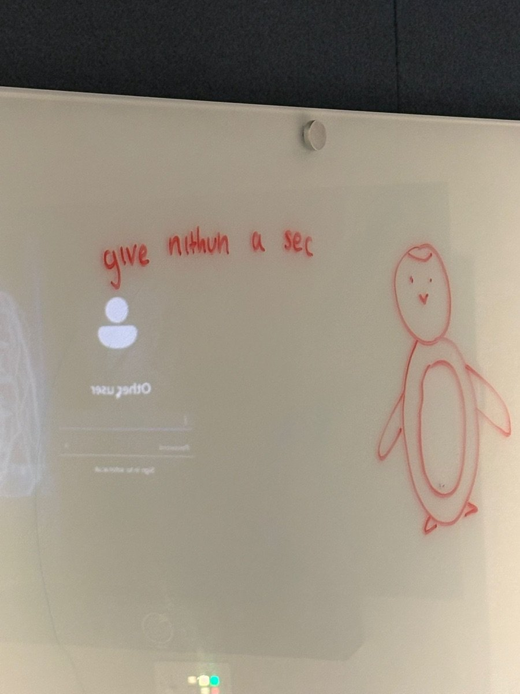

# Ariadne

**A vision-guided autonomous rover that finds marker gates with a camera and threads its way through them.**


[](https://www.youtube.com/watch?v=BA4ykBaHccs)

*▶ Watch the rover run the course (YouTube)*

### What the rover sees



*The live debug stream from the rover's camera. Both marker cards are
detected and decoded (boxed), paired into a gate (yellow line), and the gate
centre (yellow dot) is tracked. The rover is on gate #4 (lower-case letters)
in the `TRACKING` state, sending steering letter `i`: steer slightly left.*

## Why "Ariadne"?

In Greek myth, Ariadne gave Theseus a ball of thread so he could find his
way through the Labyrinth. This rover has no map of its course either: it
follows a thread of visual cues, one gate at a time, from a single camera.

## What it does

A course is marked out with gates: pairs of printed 4×4 marker cards, a
"left" card and a "right" card, standing a gate's width apart. The rover:

1. **sees** the cards with a Raspberry Pi camera,
2. **decodes** each card and pairs left/right cards into gates,
3. **steers** towards the centre of the nearest gate, and
4. **counts** each gate it drives through, then looks for the next.

Everything runs on board, in real time, with classical computer vision: no
neural networks, no GPU, no external positioning.

## How it works

```
 Raspberry Pi (Python, OpenCV)                                Raspberry Pi Pico (C++)
┌──────────────────────────────────────────────────────┐     ┌──────────────────────────┐
│ camera ─► squares ─► markers ─► gates ─► tracker ─►  │     │  receiver ─► steering    │
│ 1280×720  adaptive   4×4 grid   left/    EMA +       │UART │  freshest    letter ─►   │
│ 25 fps    threshold  decode +   right    dropout     │────►│  letter      wheel       │
│           + quad     Hamming    pairing  memory      │9600 │              speeds ─►   │
│           filters    matching   + score              │baud │  slew limit ─► 2× PWM    │
│                                    navigator ─► 'A'..'Z'   │  300 ms failsafe         │
└──────────────────────────────────────────────────────┘     └──────────────────────────┘
```

### Computer vision pipeline ([`vision/`](vision/))

| Stage | Module | What happens |
|---|---|---|
| Candidates | [`squares.py`](vision/rover_vision/squares.py) | Gaussian blur → adaptive threshold (robust to uneven lighting) → contours → keep convex quadrilaterals passing area, aspect-ratio and side-ratio checks. |
| Decoding | [`markers.py`](vision/rover_vision/markers.py) | Perspective-warp each quad to an 80×80 patch, Otsu-threshold it, sample the inner 4×4 cells, then match against the known patterns by **Hamming distance in all four rotations**, so cards work at any orientation and survive a couple of misread cells. Duplicate contours of the same card are suppressed. |
| Pairing | [`gates.py`](vision/rover_vision/gates.py) | Every left/right pair is a candidate gate. Pairs are rejected if the cards' apparent sizes differ (they would be at different depths) or the line between them is too steep. Survivors are scored by width (nearer gates look wider) plus size match and levelness. |
| Tracking | [`tracker.py`](vision/rover_vision/tracker.py) | An exponential moving average smooths the gate centre, and the last gate is held for a few frames to bridge motion blur and dropouts. |
| Steering | [`steering.py`](vision/rover_vision/steering.py) | The frame is split into 26 vertical zones; the gate centre's zone is sent as a letter, `A` (far left) to `Z` (far right). |
| Navigation | [`navigator.py`](vision/rover_vision/navigator.py) | A state machine (`SEARCHING → TRACKING → DROPOUT → CLEARING`) tells "haven't found a gate yet" apart from "the gate has slid out of view because I'm driving through it", drives straight through, and counts gates. Letter case alternates per gate (`A–Z`, then `a–z`). |

### The pipeline, stage by stage

<table>
  <tr>
    <td width="50%"></td>
    <td width="50%"></td>
  </tr>
  <tr>
    <td><em><b>Stage 1: candidates.</b> Adaptive thresholding and quad filtering find every marker border, with consistently ordered corners (0–3) and pixel area.</em></td>
    <td><em><b>Stages 2–3: decoding and pairing.</b> Each card is decoded as <code>right</code> (red) or <code>left</code> (green). With four cards in view, the widest valid pair is chosen as the gate; its centre (yellow) falls in the <code>GO</code> zone.</em></td>
  </tr>
  <tr>
    <td></td>
    <td></td>
  </tr>
  <tr>
    <td><em><b>In clutter.</b> The same pipeline in a busy lab: square-ish objects such as wall keypads are found but decoded as <code>unknown</code> and ignored, so only real markers form the gate.</em></td>
    <td><em><b>Earlier prototype: PnP pose.</b> Perspective-n-Point recovers the distance (24.6 cm), bearing and elevation of a single marker from one camera. The final rover steers from the gate centre alone.</em></td>
  </tr>
</table>

### Motor controller ([`firmware/`](firmware/))

The Pico turns letters into differential wheel speeds:

- **Continuous steering:** one wheel holds the cruise speed while the other slows in proportion to how far the gate is off-centre. The six centre zones are a deadband, so CV jitter doesn't make the rover wobble.
- **Slew-rate limiting:** wheel speeds change by at most 8/255 per 40 ms cycle, so a stream of letters (`G → H → … → M`) becomes a smooth curve rather than a series of jerks.
- **Freshest-letter receiver:** each cycle drains the UART and acts only on the newest letter, so latency never builds up.
- **Dead man's switch:** the Pi sends a letter every frame. If nothing valid arrives for 300 ms (a crash or a loose wire), the motors stop immediately.

## The build

<table>
  <tr>
    <td width="50%"></td>
    <td width="50%"></td>
  </tr>
  <tr>
    <td><em>Ariadne on the test field: a two-wheeled drum chassis with the camera mounted on top and an emergency stop.</em></td>
    <td><em>Bring-up on the lab bench: motor drivers, power distribution and the Raspberry Pi Pico before integration.</em></td>
  </tr>
  <tr>
    <td></td>
    <td></td>
  </tr>
  <tr>
    <td><em>Last-minute field repairs before a run.</em></td>
    <td><em>Lined up with the other teams' rovers on demo day (front, green wheels).</em></td>
  </tr>
</table>

<p align="center">
  <br>
  <em>Debugging the vision pipeline, as seen by the rest of the team.</em>
</p>

## Testing

The vision pipeline is tested against **synthetic camera frames**: markers
are rendered and then rotated (including 45° and 180°), put into
perspective, blurred, given sensor noise and dimmed, and the real detector
must still find and identify every one. The firmware's steering table,
slew limiter, serial receiver and failsafe are unit-tested on the host
against stubbed Pico SDK headers. Both suites run in CI on every push.

```bash
# vision (any OS)
cd vision && pip install -r requirements.txt pytest && pytest

# firmware logic (host compiler, no Pico needed)
make -C firmware/test
```

## Running it

| Where | Command |
|---|---|
| Laptop webcam demo | `cd vision && python run_webcam.py` |
| Rover | `cd vision && python run_rover.py` |
| Pi, vision only (no motors) | `python run_rover.py --no-rover --overlay`, then open the printed stream URL |
| Flash the Pico | see [`firmware/README.md`](firmware/README.md) |

Setup details, wiring and tuning: [`vision/README.md`](vision/README.md) · [`firmware/README.md`](firmware/README.md) · [`docs/protocol.md`](docs/protocol.md)

## Repository layout

```
vision/                 Raspberry Pi: camera → steering letters
  rover_vision/         the pipeline, one module per stage
  run_rover.py          on-rover entry point
  run_webcam.py         laptop demo
  calibrate_patterns.py capture marker grids with a webcam
  tests/                synthetic-image test suite
firmware/               Raspberry Pi Pico motor controller
  src/                  rover_move.hpp (logic) + main.cpp (state machine)
  test/                 host-side unit tests
docs/                   serial protocol, images
```

## Hardware

- Two-wheeled drum chassis with large 3D-printed wheels and a hardware emergency stop
- Raspberry Pi 4 with an OV5647 camera module
- Raspberry Pi Pico (RP2040) driving two DC motors through a dual motor driver (DIR + PWM per motor)
- Printed 4×4 marker cards on gate posts

## Team

Built as a group project at the University of Southampton by
**Nithun Sundarrajan**, **Emre** ([@emrekrst](https://github.com/emrekrst)),
**Shabarinath Hari** ([@shabarinath-hari](https://github.com/shabarinath-hari)) and
**Andre Cicalese**.

**My role (Nithun):** I worked on the computer vision pipeline: marker
detection and decoding, gate pairing and scoring, and temporal tracking,
which together turn raw camera frames into a steering target.
